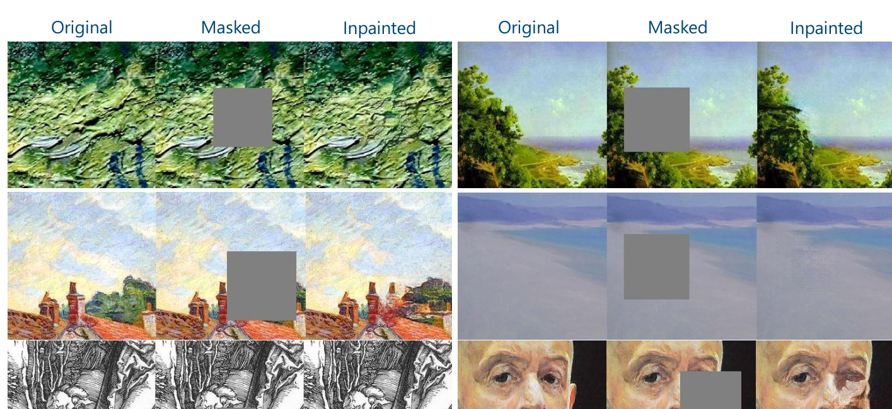
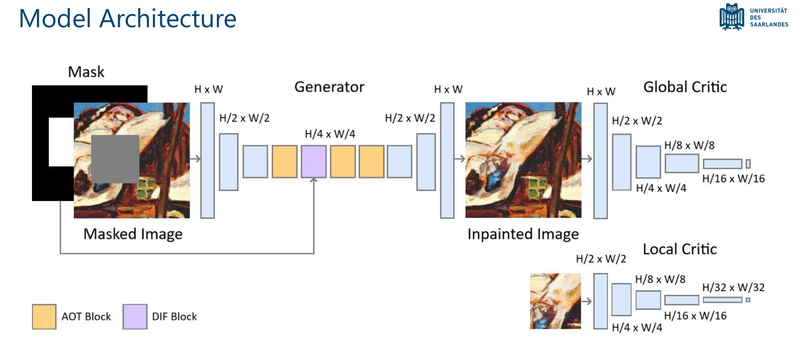
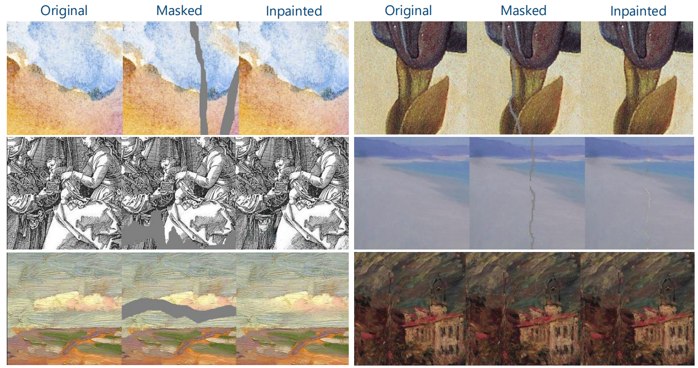
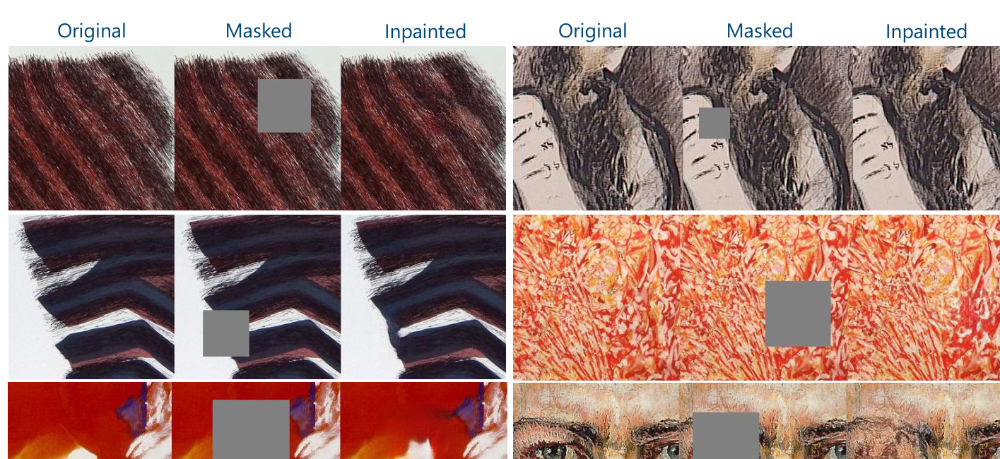
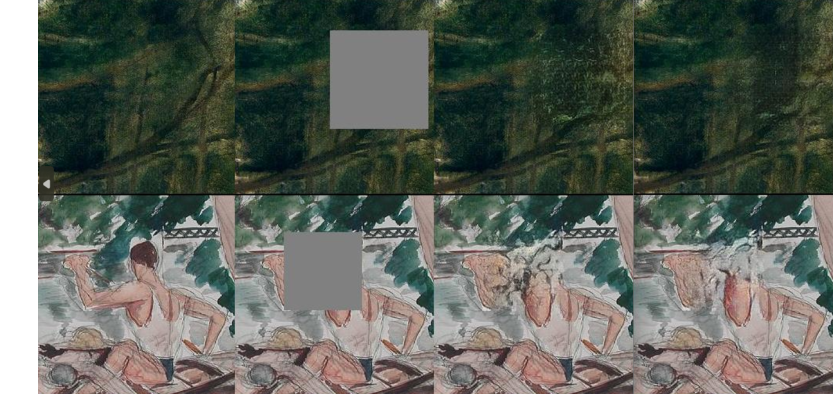
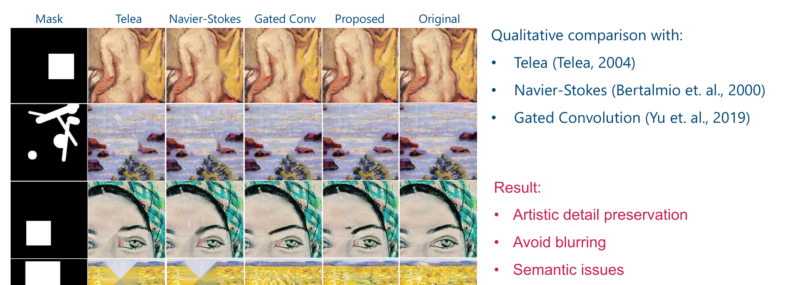

# 🎨 Inpainting Artworks with Style in Mind

**Master’s thesis project**  
**M.Sc. Visual Computing, Saarland University (2025)**

This repository contains a **GAN-based artwork inpainting** approach for digitally restoring damaged paintings.  
The goal is to fill missing or degraded regions while preserving the **style, texture, brushwork, and structural continuity** of the surrounding artwork.

Unlike many restoration pipelines, the model works **without style labels or external guidance**. It uses only the **masked artwork** and the corresponding **mask**.

<p align="center">
  
</p>

---

## ✨ Highlights

- **Artwork-focused inpainting** rather than natural-image inpainting
- **Single model for different styles** without categorization or extra cues
- **AOT-based generator** for multi-scale contextual reasoning
- **DIF block** for edge-aware refinement
- **Global + local critics** for realism and local consistency
- Loss design tailored to artworks, including **feature matching, style, perceptual, and edge losses**

---

## 🧠 Method Overview

The model is built around a generator–critic framework:

- **Generator:** encoder–decoder with **AOT blocks** and a **DIF block**
- **Global critic:** checks full-image realism
- **Local critic:** focuses on the repaired region
- **Losses:** adversarial, multi-scale L1, feature matching, edge, style, perceptual, and total variation

<p align="center">
  
</p>

### Main design ideas

- **AOT blocks** help aggregate context at multiple receptive fields.
- **DIF block** supports edge continuity and smoother transitions near missing regions.
- **Feature matching** improves visual stability and reduces hallucinated artifacts.
- The method is designed to preserve **artistic detail**, not just produce a plausible fill.

---

## 📊 Experimental Setting

### Data

- **WikiArt-limited**
- **WikiArt-full**
- Random **256 × 256** crops per artwork
- Train / validation / test split

### Mask types

- **Square masks**
- **Irregular masks**
- **Crack masks** for restoration-focused testing

---

## 🖼️ Results

### WikiArt-limited examples

The method performs well especially on:

- brushwork preservation
- local style consistency
- line continuation
- texture-heavy regions

Common failure cases include:

- **large semantic gaps**
- **flat color regions**

<details>
<summary><strong>Show crack restoration examples</strong></summary>
<br>
<p align="center">
  
</p>
</details>

<details>
<summary><strong>Show extended dataset examples</strong></summary>
<br>
<p align="center">
  
</p>
</details>

### Feature matching ablation

Feature matching gave the clearest benefit in **visual quality**, especially by reducing flaws in smooth regions and reducing hallucination.

<p align="center">
  
</p>

### Baseline comparison

A qualitative comparison was carried out against:

- **Telea**
- **Navier–Stokes**
- **Gated Convolution**

The proposed method better preserves **artistic detail** and avoids much of the **blurring** seen in the baselines, though **semantic completion** remains challenging.

<p align="center">
  
</p>

---

## ✅ What Worked Well

- Visually pleasing restoration on **small and medium gaps**
- Strong performance on **cracks** and **textured regions**
- Good preservation of **brushwork**, **edges**, and **local artistic style**
- Better qualitative detail preservation than the compared baselines

## ⚠️ Current Limitations

- Large missing regions that remove semantic content remain difficult
- Flat and uniform color areas are harder than textured ones
- Evaluation metrics do not fully reflect artwork restoration quality

---

## 📁 Repository Structure

```text
WGAN-Artwork/
├── img/
├── models/
├── scripts/
├── utils/
├── config.py
├── dataset.py
├── evaluate.py
├── losses.py
├── main.py
├── train.py
└── README.md
```

### Important files

- `train.py` — training entry point
- `evaluate.py` — evaluation / result visualization
- `config.py` — hyperparameters and paths
- `dataset.py` — dataset handling and preprocessing
- `losses.py` — loss definitions
- `models/` — generator, critics, and related model components
- `img/` — sample visuals used in the project

---

## 🚀 Usage

Before training, update dataset paths and settings in `config.py`.

### Train

```bash
python train.py
```

### Evaluate / generate results

```bash
python evaluate.py
```

---

## 🛠️ Tech Stack

- **Python**
- **PyTorch**
- **NumPy**
- **Matplotlib**

---

## 📚 References

This work builds on ideas from:

- Generative Adversarial Networks (**GANs / WGAN-GP**)
- Aggregated Contextual Transformations (**AOT blocks**)
- Classical and deep image inpainting methods
- Artwork restoration and digital inpainting literature

---

## 📄 License

This project is released under the **MIT License**. See `LICENSE` for details.
